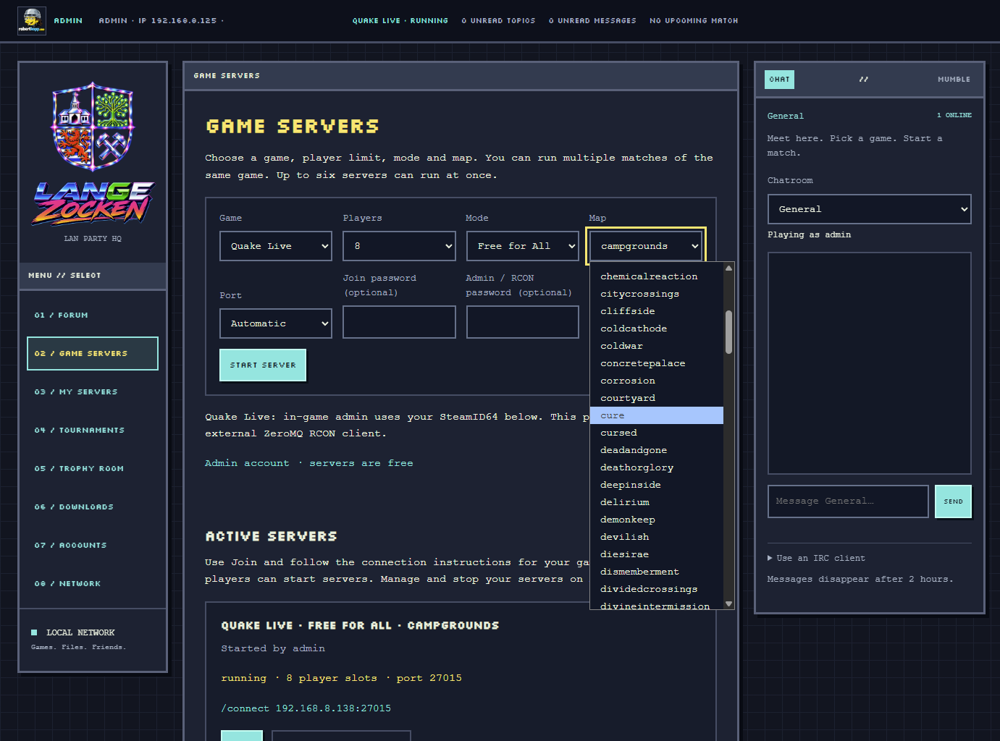

# LISP — LAN party portal

LISP brings the people, files and services of a LAN party into one locally hosted
web portal. Players can talk, share downloads, organize tournaments and manage
their game servers. Administrators manage accounts, local credits and Internet
access from the same interface.

The project runs on a Linux LAN host, with deployment scripts for CachyOS/Arch.
Its retro pixel interface has navigation on the left, the selected module in the
middle, and text chat or voice channels on the right. The current installation
is at **https://192.168.8.138/**; HTTP redirects to HTTPS.

## Portal modules

| Module | What it provides | Guide |
| --- | --- | --- |
| **Forum — home** (`/forum/`) | Simple Machines Forum with General, Games, Servers, Tools, Emulators and Tournaments boards, private messages, profiles and avatars. Logged-in users land here. | [Accounts and forum](docs/ACCOUNTS-FORUM.md) |
| **Game Servers** (`/servers/`) | Choose an installed game, mode, map, player limit, port and supported join/admin options. Start a match or use Join on an active server. | [Game server guide](docs/GAME-SERVERS.md) |
| **My Servers** (`/my-servers/`) | Owners manage Stop, Restart, stopped-server port changes and recoverable deletion. Settings and persistent worlds remain available; admins can manage other owners' entries. | [My Servers](docs/MY-SERVERS.md) |
| **Tournaments** (`/tournaments/`) | Game voting, signups and Bracket tournament management. Results update the forum and award trophies; unfinished events can be cancelled and restored. | [Community integration](docs/COMMUNITY.md) |
| **Trophy Room** (`/trophies/`) | Players' forum avatars and gold, silver and bronze totals. Select a player to see the games, tournaments and dates behind their trophies. | [Trophy Room](docs/TROPHY-ROOM.md) |
| **Downloads** (`/downloads/`) | A folder tree of local games, patches, tools and other shared files, with resumable download links. | [File sharing below](#local-file-sharing) |
| **Accounts — admin** (`/accounts/`) | Create and manage accounts, roles, temporary passwords and player interface bindings. Add Credit Tokens and set charging rates and the negative-balance limit. | [Accounts](docs/ACCOUNTS-FORUM.md), [credits](docs/CREDITS-AND-LOAD.md) |
| **Network — admin** (`/admin/`) | Connected-device discovery, global/per-device Internet controls, and managed LAN bridge/separate plans with preview and automatic rollback. | [Network management](docs/NETWORK.md) |

### Shared chat and voice

The **CHAT // MUMBLE** sidebar switches between text chat and the live voice
channel tree. General, Shooter and Strategy are available in both. Text chat
uses the portal identity, works with authenticated IRC clients, and deletes
messages after two hours. Mumble's Join voice control opens the desktop app;
the viewer grows with channel occupants. Native voice identities are separate
from portal accounts. See [chat](docs/CHAT.md) and [Mumble](docs/MUMBLE.md).

### Server load and Credit Tokens

Server cards show CPU use and average LAN traffic. Player-owned servers consume
local Credit Tokens according to measured CPU time and network bytes. Admins
can add tokens, set their worth and allow a limited negative balance. At that
limit, the player's servers save and stop while retaining their entries and
worlds. Admin-owned servers are free. Real payments are not connected.
See [load and credits](docs/CREDITS-AND-LOAD.md).

## How the modules work together

One local account connects the portal, forum, text chat, tournaments, trophies
and server ownership. Only the login screen and public appearance/login assets
are accessible to guests. Player accounts and sessions are bound to the
server-observed LAN IP/MAC; administrator accounts have no interface restriction.
Passwords, session expiry, roles and CSRF protection still apply. Log out and
Change password are at the bottom of the forum.

A tournament vote creates a forum thread and keeps its results updated. The
winning game opens tournament signups and links to its server launcher. Confirmed
final placings publish to the thread and award trophies in the Trophy Room and
forum profiles. Cancelling an unfinished tournament preserves its roster and
bracket for restoration. Game-server launch and score entry remain organizer
actions; they are not automated from the bracket.

The shared top bar shows your avatar, name, role and current network observation,
plus your running servers, unread forum topics/messages and upcoming tournament
match. Its links lead to the relevant module; the avatar opens your forum profile.

## Local file sharing

Upload files through SFTP to **`/srv/lan-party/files`** using the host's existing
upload account. The download index scans this folder about once a minute, and
its timer starts after reboot. Reload an open Downloads page to see new files.
Direct file URLs, HEAD requests and resumable ranges require portal login too.
Uploads use SSH/SFTP credentials, separately from portal accounts.

## Installation and operation

The base host needs systemd, nginx, Python 3, NetworkManager, nftables, UFW,
OpenSSL and dnsmasq. See the [network guide](docs/NETWORK.md). Copy the source project to the
Linux host and use an existing upload account:

```sh
sudo env BOOTSTRAP_IP=YOUR_ADMIN_PC_LAN_IP UPLOAD_USER=YOUR_UPLOAD_USER bash scripts/install.sh
```

Defaults are `LAN_HOST=192.168.8.138` and `LAN_CIDR=192.168.8.0/24`; pass these
variables with your own network settings when deploying elsewhere. Bootstrap
migrates an existing administrator or prompts for an initial password. Trust the
local CA at `/style/lisp-lan-ca.crt` after checking it with the LAN host.

The base installer supplies the portal, downloads, accounts, launcher, network
management and text chat. Community and voice installation have their own
instructions in [Community](docs/COMMUNITY.md) and [Mumble](docs/MUMBLE.md).
Install game runtimes separately using the [game server guide](docs/GAME-SERVERS.md).
Stop active matches before reinstalling the base portal: it restarts the game
controller. Firewall rules and managed gateway activation are separate steps;
review the module guides for their LAN-scoped settings.

Network controls affect clients using this PC as their managed gateway. Devices
using another router directly are listed for information only. See
[network operation and rollback](docs/NETWORK.md). For the host's reversible
idle/sleep prevention, see [power management](docs/POWER-MANAGEMENT.md).

## Project structure

| Folder | Contents |
| --- | --- |
| `src/` | Python portal services, account/community logic, chat, network helpers, monitoring, credits and engine adapters; the Mumble viewer uses JavaScript. |
| `web/` | Shared shell, module pages, browser behavior and portal styling. |
| `forum/` | Local Simple Machines Forum integration and theme files. |
| `scripts/` | Module installers, deployment/recovery tools and the `lan-server` CLI. |
| `config/` | nginx routes, systemd services/timers and runtime configuration templates. |
| `tests/` | Module tests and live integration checks. |
| `docs/` | Setup, operation, engine details and [validation results](docs/VALIDATION.md). |
| `style/`, `avatar/` | Supplied visual assets and local fonts. |

`LISP.MD`, `GAMES.MD` and `quake live.MD` retain the original planning notes and
implementation history. The guides above describe current operation.

## Portal and LAN illustrations

<p align="center">
  
</p>

<p align="center">
  
</p>

## Sharing and licenses

Share the source, not the running host's private state. Game Files, game binaries,
ISOs, saved worlds, runtime instances, private databases, credentials and keys
are excluded from the source package and Git. Back up the account, community,
forum and world data privately using the module guides; recipients supply their
own game-server files and credentials.

No license has been chosen for LISP's own source. Third-party software retains
its licenses; see [third-party notices](THIRD-PARTY.md). The local Silkscreen font
license is [included](style/Silkscreen-OFL.txt), and the artwork comes from the
project's supplied assets.
